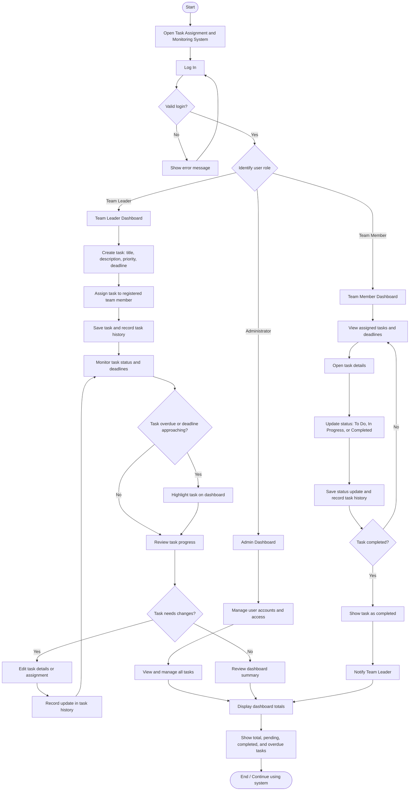

# Task Assignment and Monitoring System (TAMS)

A responsive, role-based web application for assigning tasks, tracking progress, monitoring deadlines, recording audit history, and overseeing team completion.

---

## 📋 System Overview

The **Task Assignment and Monitoring System (TAMS)** provides a centralized workflow for teams to coordinate work, meet deadlines, and preserve full accountability.

### User Roles
- 👑 **Administrator**: Full system oversight, user account management (add, edit, activate/deactivate), access control, and ability to manage all tasks.
- 🎯 **Team Leader**: Creates tasks, assigns work to team members, sets priorities and deadlines, monitors team completion, and receives completion notifications.
- 💻 **Team Member**: Views personalized assigned tasks, monitors upcoming deadlines, and updates task progress through To Do, In Progress, and Completed states.

---

## ✨ Main Features

1. **Task Creation**  
   Create tasks with descriptive titles, instructions/deliverables, priority rankings, and precise deadline dates and times.
2. **Task Assignment**  
   Assign or reassign tasks directly to registered active team members with automatic in-app notification alerts.
3. **Task Status Tracking**  
   Progress tasks seamlessly through standard workflows: `To Do` ➔ `In Progress` ➔ `Completed` (with reopening support).
4. **Priority Management**  
   Categorize tasks with clear visual indicators: `Low`, `Medium`, `High`, and `Urgent 🔥`.
5. **Deadline Monitoring & Overdue Alerts**  
   - Dedicated warning banners for overdue tasks.
   - Dynamic countdown badges: *Overdue by Xd*, *Due in X hours*, or *Due in X days*.
   - Quick filters to isolate overdue tasks and tasks due within 48 hours.
6. **Task Editing**  
   Authorized users (Administrators & Team Leaders) can edit titles, descriptions, priority levels, deadlines, and assignees at any time.
7. **Task History & Audit Trail**  
   Every lifecycle event is recorded in a tamper-evident audit log:
   - Task creation date and author
   - Assignment and reassignment history
   - Detail modifications (title, priority, deadline changes)
   - Status transitions and completion timestamps with actor identification
8. **Interactive Task Dashboard**  
   Real-time metric counters showing:
   - **Total Tasks** in scope
   - **Pending Tasks** (To Do + In Progress)
   - **Completed Tasks**
   - **Overdue Tasks**
   - **Due Soon Tasks** (next 48 hours)
   - Live activity audit stream sidebar
   - Multi-facet search and filter by status, priority, and assignee
9. **Message Notifications & Team Discussions**  
   - **Direct & Broadcast Message Notifications**: Compose and send targeted message notifications to individual team members or broadcast to the entire team.
   - **Task Discussions**: In-task message threads with instant notifications delivered to assigned members, task creators, and team leaders.
   - **Live Notification Alerts**: Real-time background polling with interactive toast notifications, synthesized Web Audio chime, bell badge counters, and browser desktop notifications.
   - **Integrated Audit Trail**: Task messages are automatically preserved in the task audit history with actor details and timestamps.

---

## 👥 Role Permissions Matrix

| Capability | Administrator | Team Leader | Team Member |
|---|:---:|:---:|:---:|
| **Manage User Accounts** (Create, Edit, Deactivate) | ✅ Yes | ❌ No | ❌ No |
| **Create New Tasks** | ✅ Yes | ✅ Yes | ❌ No |
| **Assign / Reassign Tasks** | ✅ Yes | ✅ Yes | ❌ No |
| **Edit Task Details & Deadlines** | ✅ Yes | ✅ Yes | ❌ No |
| **Delete Tasks** | ✅ Yes | ❌ No | ❌ No |
| **Update Task Status** | ✅ All Tasks | ✅ All Tasks | ✅ Assigned Tasks Only |
| **View Task History & Audit Trail** | ✅ All Tasks | ✅ All Tasks | ✅ Assigned Tasks Only |
| **Send Message Notifications** | ✅ Yes | ✅ Yes | ✅ Yes |
| **Task Discussions & Messaging** | ✅ All Tasks | ✅ All Tasks | ✅ Assigned Tasks Only |
| **Dashboard Scope** | System-wide | Team-wide | Assigned Tasks |

---

## 🔑 Default Demo Accounts

The system comes pre-seeded with sample users and realistic task data. You can log in using the credentials below or click any of the 1-click demo buttons on the login screen and top switcher bar:

| Role | Username | Password | Email |
|---|---|---|---|
| **Administrator** | `admin` | `admin123` | admin@tam-system.local |
| **Team Leader** | `leader` | `leader123` | marcus@tam-system.local |
| **Team Member** | `member1` | `member123` | sarah@tam-system.local |
| **Team Member** | `member2` | `member123` | david@tam-system.local |
| **Team Member** | `member3` | `member123` | aaliyah@tam-system.local |

---

## 🛠️ Technology Stack & Architecture

- **Backend**: PHP 8.0+ (PDO, Session-based Authentication, RESTful JSON API endpoints)
- **Database**: Dual-driver support:
  - **SQLite (Default)**: Zero-configuration file database located in `data/tams.sqlite` (auto-created on first load).
  - **MySQL / MariaDB**: Fully compatible with XAMPP MySQL. Can be enabled by switching `DB_DRIVER` in `config/config.php` to `'mysql'`.
- **Frontend**: Clean Modern CSS (CSS Grid, Flexbox, Glassmorphism, Dark Mode) and Modular Vanilla JavaScript (fetch API, event delegation, responsive UI).

---

## 🚀 Setup & Installation (XAMPP)

1. **Place Project in XAMPP `htdocs`**:
   Ensure this project folder is located at:
   ```
   C:\xampp\htdocs\lotttyy
   ```
2. **Start Apache via XAMPP Control Panel**:
   - Open XAMPP Control Panel and start **Apache**.
3. **Open in Web Browser**:
   Navigate to:
   ```
   http://localhost/lotttyy/login.php
   ```
   or
   ```
   http://localhost/lotttyy/
   ```
4. **Instant Database Initialization**:
   The SQLite database and seed records (users, realistic tasks, audit logs, and notifications) are automatically initialized on the first request.

*(Optional) Using MySQL instead of SQLite:*
1. Start **MySQL** in XAMPP.
2. In `config/config.php`, change:
   ```php
   define('DB_DRIVER', 'mysql');
   ```
3. Import `database/schema.sql` via phpMyAdmin (`http://localhost/phpmyadmin/`) or let TAMS auto-create the schema.

---

## 🔄 System Flowchart



---

## 🚀 CI/CD & Automated FTP Deployment

This repository includes an automated GitHub Actions pipeline located at [`.github/workflows/deploy.yml`](.github/workflows/deploy.yml):

1. **Continuous Integration (CI)**:
   - Sets up PHP 8.2 environment.
   - Automatically scans and lints all PHP files (`php -l`) to catch syntax errors before deployment.
2. **Continuous Deployment (CD)**:
   - On successful push to `main` (or manual trigger via GitHub Actions tab), syncs files directly to your web host via FTP.
   - Requires the following repository secrets under **GitHub Repository Settings > Secrets and variables > Actions**:
     - `FTP_SERVER`: Your FTP server hostname or IP (e.g. `ftpupload.net` or `ftp.yourdomain.com`).
     - `FTP_USERNAME`: Your FTP account username.
     - `FTP_PASSWORD`: Your FTP account password.
     - *(Optional)* `FTP_SERVER_DIR`: Destination directory on server (e.g. `public_html/` or `htdocs/`, default: `./`).
     - *(Optional)* `FTP_PROTOCOL`: Protocol (`ftp` or `ftps`, default: `ftp`).

---

## 📄 License
This project is open-source under the MIT License.
