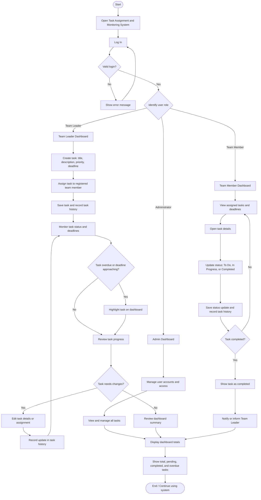
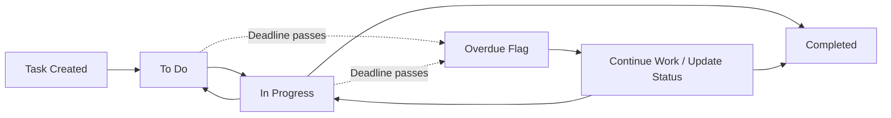

# Task Assignment and Monitoring System

## 1. System Overview

The **Task Assignment and Monitoring System** helps a team create tasks, assign responsibilities, track progress, monitor deadlines, and review task history.

### User Roles

- **Administrator:** Manages user accounts and system access; can view and manage all tasks.
- **Team Leader:** Creates tasks, assigns them to team members, sets priorities and deadlines, and monitors team progress.
- **Team Member:** Views assigned tasks, updates task status, and checks task details and deadlines.

## 2. System Flowchart

## 3. Main Process Description

1. **Login:** The user enters their account credentials. The system checks whether the login details are valid.
2. **Role-based dashboard:** The system opens the dashboard according to the user's role.
3. **Task creation:** The Administrator or Team Leader creates a task with a title, description, priority, and deadline.
4. **Task assignment:** The task is assigned to a registered team member and saved in the system.
5. **Task tracking:** Team Members view their assigned tasks and update each task to **To Do**, **In Progress**, or **Completed**.
6. **Deadline monitoring:** The system checks deadlines and highlights upcoming or overdue tasks.
7. **Task editing:** Authorized users edit task details or assignments. Every update is recorded in task history.
8. **Task completion:** When a Team Member marks a task as completed, the system saves the status and records the completion.
9. **Dashboard reporting:** The dashboard displays the total number of tasks, pending tasks, completed tasks, and overdue tasks.

## 4. Task Status Flow

**Note:** “Overdue” is a deadline condition, not a replacement for the task's progress status. A task can be marked overdue while still being To Do or In Progress.

## 5. Dashboard Information

The dashboard should display:

- **Total Tasks:** All tasks recorded in the system.
- **Pending Tasks:** Tasks not yet completed, including To Do and In Progress.
- **Completed Tasks:** Tasks marked Completed.
- **Overdue Tasks:** Tasks whose deadlines have passed and that are not completed.
- **Upcoming Deadlines:** Tasks with deadlines approaching.

## 6. Task History

For auditing and accountability, the system records:

- Task creation date and creator
- Task assignment and reassignment
- Changes to task title, description, priority, or deadline
- Status updates
- Task completion date and person who completed it

## 7. Suggested Access Rules

| Feature | Administrator | Team Leader | Team Member |
|---|---|---|---|
| Manage user accounts | Yes | No | No |
| Create tasks | Yes | Yes | No |
| Assign or reassign tasks | Yes | Yes | No |
| View all team tasks | Yes | Yes | No |
| View assigned tasks | Yes | Yes | Yes |
| Update task status | Yes | Yes | Yes, for assigned tasks |
| Edit task details | Yes | Yes, for managed tasks | No |
| View task history | Yes | Yes, for managed tasks | For assigned tasks |
| View dashboard | All tasks | Team tasks | Personal assigned tasks |

These access rules are a suggested starting point and can be adjusted to match the team's requirements.
